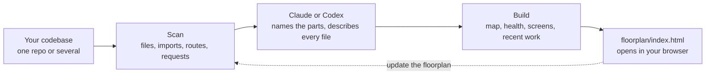

<div align="center">

<picture>
  <source media="(prefers-color-scheme: dark)" srcset="docs/images/logo-dark.png">
  
</picture>

# Floorplan

**See how your app actually fits together.**

Claude or Codex reads your codebase and draws an interactive map of it. Every part, file and web request gets a plain-English name, and every connection between them is shown.

[](https://code.claude.com/docs/en/overview)
[](docs/codex.md)
[](https://github.com/haydenschmitty/floorplan/actions/workflows/test.yml)
[](CHANGELOG.md)
[](LICENSE)
[](https://nodejs.org)
[](#how-it-works)

**[Try the live demo](https://haydenschmitty.github.io/floorplan-demo/)** · [Watch the video](https://youtu.be/NTUUzC7L_NQ) · [Install](#install) · [Quick start](#quick-start) · [Features](#features) · [See it in action](#see-it-in-action) · [How it works](#how-it-works) · [Docs](docs/README.md) · [FAQ](#faq)

</div>

<p align="center">
  <a href="https://youtu.be/NTUUzC7L_NQ"></a>
</p>
<p align="center"><sub>▶ <a href="https://youtu.be/NTUUzC7L_NQ">Watch the walkthrough</a>: installing Floorplan, then a tour of Brewline, a demo coffee-subscription app built across four repos.</sub></p>
<p align="center"><b><a href="https://haydenschmitty.github.io/floorplan-demo/">Try the live demo →</a></b> Explore the Brewline map in your browser, no install needed.</p>

## Why Floorplan?

You built an app, probably with a lot of help from AI, and it works. But ask "what happens when someone checks out?" or "what breaks if I change this?" and the honest answer is *no idea*.

Floorplan gives you the diagram nobody drew. Ask Claude Code or Codex for a floorplan and a few minutes later you have a map you can explore, ask questions on, and keep up to date as you work.

- **For builders:** understand the app you made, in your own words, without reading the code.
- **For teams:** onboard someone in minutes, from the big picture down to the exact file.
- **For working with AI:** after every change Claude or Codex makes, see exactly which parts it touched and why.

## Features

<table>
<tr>
<td width="50%" valign="top">

**🗺️ A map at every zoom**<br>
Start with the whole app, then double-click into a part, a group of files, a file, and its endpoints. Each view shows what it's used by and what it uses.

</td>
<td width="50%" valign="top">

**💬 Plain English everywhere**<br>
"Takes card payments at checkout", not "Stripe API wrapper". Technical terms are explained on hover, and one switch shows the developer view.

</td>
</tr>
<tr>
<td valign="top">

**🔌 Real connections, across repos**<br>
It follows imports, and matches each web request in your frontend to the server endpoint that answers it, even across separate repos.

</td>
<td valign="top">

**🖥️ Start from a screen**<br>
Pick a page you know and see everything behind it: its parts, the requests it makes, the server code, the data, and outside services.

</td>
</tr>
<tr>
<td valign="top">

**🧭 Ask the map**<br>
"How does a refund reach the customer's card?" comes back as an answer plus a mini-map of just the pieces involved, with a step-by-step walkthrough.

</td>
<td valign="top">

**🩺 Health check**<br>
Finds passwords in code, endpoints anyone can use without signing in, unused files and files too big to edit safely. Each comes with a ready-to-paste fix.

</td>
</tr>
<tr>
<td valign="top">

**🟢 Recent work**<br>
The cards your AI just changed light up green, each with a note on how the change serves what you asked for.

</td>
<td valign="top">

**⚡ Stays current, stays yours**<br>
Updates re-read only what changed, and an open map reloads itself. Everything runs on your machine, and nothing is committed to git.

</td>
</tr>
</table>

Plus guided **flows** you can request in plain words, a one-minute **Start here** tour, search, keyboard shortcuts, and right-click actions on every card.

## See it in action

Want to click around yourself? Open the [live demo](https://haydenschmitty.github.io/floorplan-demo/): the real Brewline map beside a scripted conversation, in Claude Code or Codex.

<table>
<tr>
<td width="50%" valign="top">

<p><b>Ask the map.</b> A real answer, from the Claude Code CLI in 31 seconds. It traced the gift from form to inbox across two repos, and spotted two bugs along the way.</p>
</td>
<td width="50%" valign="top">

<p><b>Start from a screen.</b> Pick any page and see everything behind it, from the button down to the database and outside services.</p>
</td>
</tr>
<tr>
<td valign="top">

<p><b>Recent work.</b> What you asked for, what changed, and why each change was needed, on one board.</p>
</td>
<td valign="top">

<p><b>Health check.</b> A password left in the code and an endpoint anyone can call, each with a one-click fix prompt.</p>
</td>
</tr>
<tr>
<td valign="top">

<p><b>Zoom in.</b> Inside any part: what's in it, what uses it, and what it relies on. Green tags mark what just changed.</p>
</td>
<td valign="top">

<p><b>Guided flows.</b> Watch a request travel through the app step by step, or ask for a new one to be traced.</p>
</td>
</tr>
</table>

## Install

You need [Node.js 18+](https://nodejs.org) and either Claude Code or Codex. Floorplan runs on the plan you already have, with no API keys.

### Claude Code

In the desktop app's Code tab or the CLI:

```bash
claude plugin marketplace add haydenschmitty/floorplan
claude plugin install floorplan@floorplan
```

Start a new session and it's ready. Installing the Claude Code CLI is recommended even if you use the desktop app, because it lets the map's Ask bar read your real code. More in [Getting started](docs/getting-started.md).

### Codex

Signed in with ChatGPT. No terminal needed:

1. In the Codex app, open **Plugins** and choose **Add a marketplace**.
2. For **Source**, enter `haydenschmitty/floorplan` and click **Add marketplace**.
3. Find **Floorplan** and click **+** to install it.

Or, from a terminal:

```bash
codex plugin marketplace add haydenschmitty/floorplan
codex plugin add floorplan@floorplan
```

Start a new chat and ask for a floorplan, or type `$floorplan`. The map's Ask bar runs on your own Codex sign-in, with no API key. More in [Floorplan in Codex](docs/codex.md).

## Quick start

1. Open your project in Claude Code or Codex. For a frontend and backend in separate repos, open the folder that holds both.
2. Ask:
   > Make me a floorplan of this app.

   (In Codex you can also type `$floorplan`.)
3. Explore. The map opens on its own, starting with a short tour.

When you've done more work, ask:

> Update the floorplan.

Only what changed is re-read, and what you just worked on lights up under **Recent work**.

### Things to try

| Ask Claude Code or Codex | Ask the map |
|---|---|
| "Make me a floorplan of this app" | "What happens when someone places an order?" |
| "Update the floorplan" | "Where do we talk to Stripe?" |
| "Fix the important issues from the floorplan's Health check" | "If I change the users table, what breaks?" |
| "Add a flow showing how a new user signs up" | "Which files handle login?" |
| "Rewrite the floorplan for developers" | "What did we change for refunds?" |

## How it works



Scripts do the mechanical work: finding repos, parsing code in a dozen languages, matching web requests to endpoints, laying out the map. They're plain Node with no dependencies. Claude or Codex does the part only a reader can: deciding what the parts of your app *are*, and saying so plainly. Details in [How it works](docs/how-it-works.md).

**Languages:** TypeScript, JavaScript, Python, Go, Rust, Java, Kotlin, Scala, plus Vue, Svelte and Astro files, with lighter support for others.<br>
**Endpoints:** Express, Koa, Hono, Next.js, Firebase Cloud Functions, Flask, FastAPI, Django, Go's net/http, Gin, Echo and chi, Actix, Axum, Spring.<br>
**Screens:** Next.js, React Router, Vue, SvelteKit, Remix, Nuxt, Astro, Expo, Angular, TanStack.

## What it adds to your project

A `floorplan/` folder holding the map. In Claude Code it also adds a short section to `CLAUDE.local.md` so future sessions know the map is there. **Neither is committed:** the folder ignores itself in git, and `CLAUDE.local.md` goes in your clone's private ignore list. In Codex, only the `floorplan/` folder is added. Your `.gitignore` and other tracked files are never touched. See [What's in your project](docs/project-files.md).

## Privacy

- The scan, the map and its small local server all run on your computer. The server only accepts connections from your own machine.
- No dependencies or install scripts, and the map works offline: its layout engine and fonts are built in.
- Questions on the map go to your own account, through the Claude Code CLI or Codex, which can read your code but not change it.
- The Health check never stores or shows secret values, only where they are.
- No analytics or tracking. The map may ask once whether you'd like an email when Floorplan Cloud launches. Nothing is sent unless you sign up, and then only your email and "just me" or "with my team".

More in [Privacy and security](docs/privacy-and-security.md).

## Documentation

| | |
|---|---|
| [Getting started](docs/getting-started.md) | Install, first map, updating, removing |
| [Floorplan in Codex](docs/codex.md) | Installing and using it in Codex |
| [ACP agents](docs/acp.md) | Ask questions through any ACP agent, like `gemini --acp` |
| [Using the map](docs/using-the-map.md) | Every button, view, shortcut and menu |
| [How it works](docs/how-it-works.md) | The pipeline, connection matching, refreshes |
| [What's in your project](docs/project-files.md) | Every file Floorplan creates, and how to edit it |
| [Privacy and security](docs/privacy-and-security.md) | What runs where, and what leaves your machine |
| [Troubleshooting](docs/troubleshooting.md) | Common problems and fixes |
| [Developing Floorplan](docs/development.md) | Repo layout, local installs, releases |

## FAQ

<details>
<summary><b>Does my code leave my computer?</b></summary>

Only the way Claude Code and Codex always work: the AI reads the files it needs to describe your app, through your own account. The map itself is a local file and its server only listens on your machine. If you choose to open the map in the Claude app instead, Claude uploads the map (names, descriptions and structure, not your source code) to your private claude.ai account, and asks first. The one thing Floorplan itself ever sends is your email, and only if you sign up for the [Floorplan Cloud waitlist](docs/privacy-and-security.md#floorplan-cloud-waitlist).
</details>

<details>
<summary><b>How long does it take, and what does it cost?</b></summary>

A first map takes a few minutes for a small app and longer for a big one, because every file and endpoint gets described. It uses your Claude or ChatGPT plan like any other task. Big projects are split across parallel helpers. Updates re-read only what changed, so they're quick and cheap.
</details>

<details>
<summary><b>Do I need a CLI for the Ask bar?</b></summary>

No. The map works without one. The Ask bar answers through the Claude Code CLI or Codex, which can read your real code. Codex's desktop app already includes what it needs. With Claude, without the CLI you can ask from the Claude app instead, using the map alone.
</details>

<details>
<summary><b>Will it change or commit my files?</b></summary>

It only writes its own `floorplan/` folder (and, in Claude Code, a section in `CLAUDE.local.md`), and neither is committed. It never changes your code, your `.gitignore` or your `CLAUDE.md`.
</details>

<details>
<summary><b>The names it picked aren't how we talk about it. Can I change them?</b></summary>

Yes. Just ask ("rename 'Main server' to 'Shop API' on the floorplan"), or edit `floorplan/architecture.json` and `floorplan/descriptions/` yourself. Your edits are kept on every update.
</details>

<details>
<summary><b>Does it work with Codex as well as Claude Code?</b></summary>

Yes. It's the same plugin, the same map and the same Health check. Each app runs it on your own plan: Claude Code on your Claude account, Codex on your ChatGPT sign-in. A map made in one opens fine with the other. See [Floorplan in Codex](docs/codex.md).
</details>

<details>
<summary><b>Does it work on monorepos and multi-repo setups?</b></summary>

Yes. Point it at a monorepo, a subfolder of one, or a plain folder that holds several repos side by side. It finds every repo and connects them.
</details>

## Contributing

Issues and pull requests are welcome. See [CONTRIBUTING.md](CONTRIBUTING.md) and [Developing Floorplan](docs/development.md).

## License

[MIT](LICENSE) © 2026 [Hayden Smith](https://github.com/haydenschmitty)
