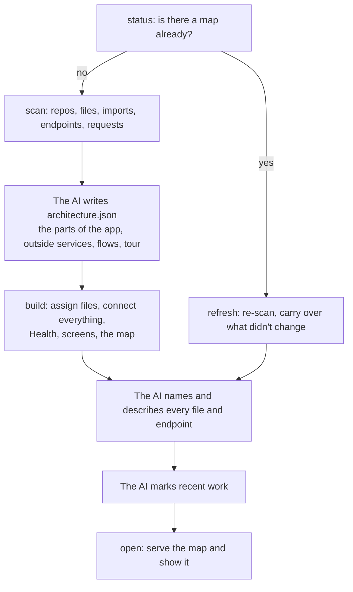

# How it works

Floorplan splits the work between scripts and the AI you run it in, Claude Code or Codex. The scripts do everything mechanical: finding files, parsing code, matching requests to endpoints, laying out the map. They're plain Node.js with no dependencies, and they cost no tokens. The AI does what only a reader of the code can: deciding what the parts of your app *are*, and explaining them plainly.

## 1. Scan

`scan.mjs` finds every git repository under the folder you point it at (one repo, a monorepo, or several repos side by side), skipping duplicate worktrees. It lists files with git, so your `.gitignore` is respected, then extracts from each file:

- **imports**, resolved to real files: TypeScript path aliases (including ones inherited through `extends`), package.json `"imports"` (`#lib/x`), Python packages, Go modules, Rust crates, JVM packages (and, in Kotlin and Java, the names a file uses from its own package without an import);
- in a **Nuxt** app, the components and composables a file uses with no import line (Nuxt's auto-imports), matched by name. When the app has been built or started once, the scan reads just the two name lists Nuxt writes, `.nuxt/components.d.ts` and `.nuxt/imports.d.ts`; otherwise it follows Nuxt's folder conventions (`components/`, with folder names as prefixes, `composables/` and `utils/`). Nothing else in `.nuxt/` is read, and it's never part of the map;
- **exported definitions** and their doc comments;
- **endpoints** the server defines;
- **web requests** the code makes;
- content **fingerprints**, so later updates can tell what changed.

Supported languages: TypeScript and JavaScript (including Vue, Svelte and Astro files), Python, Go, Rust, Java, Kotlin, Scala, Swift, C#, Groovy and PHP, and Shopify themes (Liquid), with lighter support for others. PHP files link to the classes they use: `use` statements, and the classes a file names without one (`new Order`, `Order::class`, parameter types), found by namespace and through the PSR-4 folders in `composer.json`. PHP is read, never run.

**Shopify themes.** A folder with a `layout/theme.liquid` is read as a theme. Its files reach each other by name rather than by path, so Floorplan follows `` to `snippets/price.liquid`, `` and `` to `sections/`, `` to `blocks/`, and `'theme.js' | asset_url` to `assets/`. JSON templates and section groups use the sections and theme blocks they list, including Liquid typed into a template's custom-code settings. Apps added as app blocks or app embeds show up as outside packages named `shopify-app:<app>`. Comments and `` examples are skipped. Health lists a snippet nothing renders and no other file names as unused; layouts, templates, sections and theme blocks never are, since Shopify loads them by name. A theme's Liquid files and JSON templates are code, so they're on the map rather than under NOT MAPPED. Outside a theme, `.liquid` files and `templates/*.json` are left as they were.

## 2. Connecting requests to endpoints

The most useful lines on the map connect a screen's web requests to the server code that answers them, often across repos. Floorplan:

- **Finds endpoints** in Express, Fastify (plugin prefixes included), Koa, Hono, NestJS (controller decorators), Next.js (route files and API routes), Firebase Cloud Functions, Flask, FastAPI, Django, Go (net/http, Gin, Echo, chi, Fiber), Actix, Axum, Spring and ASP.NET Core (attribute-routed controllers, conventional routes from `MapControllerRoute`, minimal APIs and SignalR hubs), and in route tables: keyed by method and path (`"GET /api/orders": listOrders`) in JavaScript and Python, listed as `{ method, path, handle }` objects (the path may be a regular expression) in JavaScript, and `Bun.serve({ routes })`.
- **Resolves prefixes**: Flask blueprints registered with a `url_prefix`, and Express and Hono routers mounted with `app.use('/api/users', usersRouter)` or `app.route('/api', api)`, whatever the router is called, including routers mounted inside other routers (in the same file or another), routers passed on by an index file (`export { default as authRoutes } from './auth.routes.js'`) or made by a function (`app.use('/billing', createBillingRoutes())`), and mounts with middleware in front; ASP.NET Core `[Route]` prefixes on controllers (a subclass's prefix for actions it inherits) and `MapGroup` prefixes on minimal APIs, including groups an endpoint-mapping extension method is called on from another file.
- **Finds requests** made with `fetch`, axios, ky, `requests`, a SignalR `withUrl(…)` and similar, including:
  - addresses built in a variable first: `const url = …; api.get(url)`;
  - template strings with nested parts;
  - small helpers in the same file that add a prefix, like `call('/definitions')`;
  - an app's own request helpers, like `apiGet('/tasks')` or `` apiSend('PATCH', `/tasks/${id}`, body) ``, with the method from the name or the first argument;
  - methods of a service class that build the address, like `this.http.post(this.url(id, '/ship'), body)` (Angular services and the like), including one that builds on another;
  - calls whose address is on the line below, like `this.http.patch<Order>(` followed by the template string.
  - the method in a call's options on the lines below its address, as in ``fetch(`/api/users/${id}`, {`` with `method: "PATCH"` underneath.
- **Laravel** routes come from `Route::get(…)`, `match`, `resource` and `apiResource` (with `only` and `except`), `Route::view` and `Route::inertia`, under prefix, name, middleware and controller groups, in the chained form or the older `Route::group([...])` one. A route file loaded inside a group (`require __DIR__.'/admin.php'`, `->group(base_path('routes/admin.php'))`, files required in a loop over a fixed list, and `withRouting` in `bootstrap/app.php`) gets that group's prefix, name and middleware. An endpoint answered by a controller method sits in the controller's file, at that method; a closure stays where it's written. Routes only running the app would reveal (built in a loop from data, or registered by a package) aren't found.
  - **Wayfinder** calls (`import { show } from '@/routes/orders'`, `OrderController.update.form(…)` from `@/actions/…`) reach their endpoints by route name or controller method, though the files Wayfinder generates aren't in git.
  - **Inertia** pages: a controller method that renders a page (`Inertia::render('orders/show')`) makes that page a screen at the endpoint's address, linked to the controller that serves it.
- **Serverless Framework** endpoints are declared in `serverless.yml` (and `serverless-*.yml`) rather than in code: each function's `http` and `httpApi` events give the addresses, including function lists spread over files included with `${file(./functions.yml)}`, and the endpoint sits in the file its `handler:` names, or in the function that handler only passes the request on to. Health counts an `authorizer` or `private: true` (an API key) as a sign-in check. Configs in test folders are left out.
- **Supabase Edge Functions**: each folder under `supabase/functions/` (except `_shared` and others starting with `_`) is one endpoint at `/functions/v1/<name>`, for any method, in its `index.ts`. A function that runs a router of its own (Hono and the like) has that router's endpoints instead, under `/functions/v1`. The website's `supabase.functions.invoke('<name>')` calls (a POST unless their options say otherwise) and requests to `…/functions/v1/<name>` reach them. Health judges each function by its own code, whatever `verify_jwt` says, since the public anon key the website ships passes that check.
- **Plain PHP sites**, with no framework routing: each script under the document root (`public/`, `public_html/`, `www/` or `htdocs/`) answers at its own address (`public/orders/save.php` at `/orders/save.php`, an `index.php` at its folder's). Scripts other scripts include, and files under folders starting with `_` or a dot, are parts of pages rather than pages. A document root whose `index.php` loads Composer's autoloader is a framework's front controller (Laravel, Symfony, Slim) and is left to the framework's routes.
- **Firebase Cloud Functions** are called by name rather than by address. A callable function (`onCall`) shows up as `CALL /approveItem` under the name your functions entry file exports it as, and the website's `httpsCallable(functions, 'approveItem')` calls reach it, including through a helper of your own that wraps `httpsCallable`. An `onRequest` function is an ordinary endpoint at `/<name>`, and an Express app passed to it keeps its own routes under that name. Scheduled and other background functions (Firestore, Storage, Pub/Sub) are listed for the AI to place on the map.
- **Matches** the two, ignoring case for ASP.NET Core, which routes that way. When a request only spells out part of the address, because the base URL lives in settings, Floorplan learns each client's base path from the calls only one endpoint could answer (shared across that client's files, up to the folder with its package.json or its repo, never with another app beside it), and prefers matches that fit it, even over a shorter address elsewhere that looks closer.

It's pattern matching, not a compiler, so it catches most connections but not all. If an important link is missing, ask for it to be added to the floorplan, and it will record it as an explicit connection.

## 3. The AI describes the system

Claude or Codex reads the scan summary, READMEs, setup files and entry points, then writes `architecture.json`:

- the main parts of your app, each with a plain summary;
- the outside services it really talks to (databases, payment providers, email);
- connections the scan can't see, like queues, scheduled jobs and webhooks;
- a few guided flows and a "Start here" tour.

The build then assigns every file to the deepest part whose patterns match, and reports anything left over.

Next, `describe.mjs` writes a worksheet for each part. A worksheet is a digest of every file and endpoint: what it defines, its doc comments, what it uses, and which files import it, send it web requests or mention it by name (so a script started from `package.json` shows who starts it). It also quotes the code of every endpoint and the whole of very short files, a few lines each and at most 120 lines a worksheet, so the AI can see when something is still a placeholder ("replies OK and keeps nothing") instead of guessing from its name. Values that might be secret are masked in those quotes, and settings files like `.env` are never quoted. The AI fills in a name and description for each, saying what the code does today. On large projects, Claude Code splits the worksheets across parallel helpers.

By default everything is written for the app's owner, not an engineer: what each thing does for the business, in everyday words. Ask for a developer-facing map and it switches to technical style.

## 4. Build

`build.mjs` validates everything the AI wrote and reports problems by name ("did you mean …"). On a map for everyone, it also warns when a part's name or summary uses developer words ("API client", "UI kit", a framework's name), and when a part holds many files that sit in folders of their own, so the AI can reword or split it. It then:

- connects the parts, using imports, matched requests and the AI's explicit connections;
- runs the **Health** check;
- detects **screens**: Next.js, React Router, Vue, SvelteKit, Remix, Nuxt, Astro, Expo, Angular, TanStack, and a Shopify theme's templates (an alternate template like `product.preorder.json` as `/products/:handle?view=preorder`);
- writes `graph.json` and the self-contained `index.html`, noting whether Claude Code or Codex made it, so the map's Ask bar and fix prompts name the right one.

The map lays itself out in your browser with [ELK](https://eclipse.dev/elk/), so the build itself is fast.

## 5. Recent work

After every make or update, the AI records what was just worked on in `recent-work.json`. `recent.mjs` lists the facts: what changed since the last map, uncommitted changes, and recent commits, each matched to its card. The AI adds the *why*: what you asked for, and how each change serves it. The previous highlights are replaced every time.

## 6. Showing it

`open.mjs` starts the map's small local server in the background and opens your browser. If the server is already running for this map, it's reused, and any open tab reloads itself in place instead of a new one opening.

## Updates

`refresh.mjs` re-scans and compares against the last build, using each file's fingerprint:

- **exact content**, which spots edits, renames and moves;
- **signature**: its exports, endpoints and doc comments. Edits inside function bodies don't count.

It then:
- carries descriptions over to moved and renamed files and endpoints;
- drops entries for deleted files;
- flags entries whose signature changed, for review.

Then it rebuilds. The AI only has to describe what's new or flagged, and check the structure if the change was large. That's why updates are quick.

## Blueprints

Everything above is how Floorplan maps existing code, its main job. A blueprint is the other way in: a map of something that isn't built yet. The AI reads a PRD or a description and writes `floorplan/plan.json`: every file and endpoint the system would need, which screen calls which endpoint, which parts use outside services and the database, and who may use each endpoint. It also lists the stack it chose, its assumptions and the questions the PRD leaves open.

`plan.mjs` turns the plan into the same scan `scan.mjs` makes from code, so the build, Screens, flows, the tour and Ask all work the same way. The differences:

- cards have dashed outlines and the board a **Blueprint** label;
- Health becomes a **design review** of the plan: endpoints anyone could use to change data, endpoints with no decision on who may use them, open questions, and pieces nothing connects to;
- every part has **Build this with Claude** (or Codex): a request to build that part as planned, listing its files, endpoints and what it relies on;
- Ask answers from the plan and the PRD, since there's no code to read;
- the Ask bar's **Change** switch takes requests like "also plan out refunds": the agent returns the updated plan, the map's server checks it with `plan.mjs` and `build.mjs` (sending problems back once), saves it and redraws the map with the changes highlighted, and **Undo** puts the previous plan back. Each design review item's **Resolve on the map** fills in that request for you: an open question just needs your answer. The agent stays read-only: only the server writes, and only `plan.json`, `architecture.json` and `recent-work.json`.

Updating a blueprint redraws it from `plan.json`. Once the code exists, `refresh.mjs --from-code` maps the real code instead, and `plan.json` stays.

## Without an agent session

The same pipeline runs without Claude Code or Codex: in CI, in a script, or from your own tooling, with any model that can read files and return JSON. `skills/floorplan/workflow.json` describes each step as data (which script to run, which job needs a model, what it's given and what it must answer), every script can report its result as JSON, and unattended mode keeps Floorplan to its own folder. See [Running Floorplan without an agent session](unattended.md).

## Asking questions

The map's server answers each question with the AI on your computer, in your project:

- **Claude Code:** it runs `claude -p` with read-only tools only: reading and searching files, and `floorplan/query.mjs`, which looks things up in the map. It starts without any of your MCP servers (`--strict-mcp-config` with an empty list), since answers never use them and their tool descriptions alone can make a question too long, and it’s told not to read the map’s own generated files.
- **Codex:** it runs `codex exec` in Codex's read-only sandbox, with the same lookups. These runs aren't saved to your Codex history, so a follow-up brings the last few questions and answers along. Codex has no option that leaves out only its MCP servers, so the ones you set up for Codex are loaded too; if questions fail as too long, turn off the ones you don't need (`enabled = false` in `~/.codex/config.toml`).

It uses whichever made the map, and the other one if that isn't installed. Either way it answers with text plus the cards to show, so answers can cite real code.

In the Claude app, the map asks Claude through the app instead, with the same lookups but no access to your source.

The same lookups help ordinary Claude Code sessions. If you say yes after your first map, the short section Floorplan adds to `CLAUDE.local.md` tells them to check the map (`query.mjs find`, `show`, `path`, `overview`) before searching the code from scratch.
